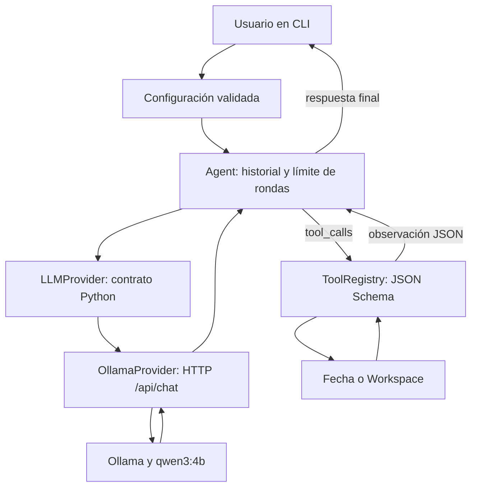

# Arquitectura de las fases 0 y 1

[Índice](../README.md) · [Roadmap](../../ROADMAP.md)

El objetivo implementado es conversar con un modelo local y ejecutar funciones Python
autorizadas. La planificación avanzada, la ejecución de código y la memoria persistente
quedan para sus respectivas fases del roadmap.



## Responsabilidades

| Archivo | Responsabilidad |
|---|---|
| `main.py` | CLI, composición de objetos y códigos de salida. |
| `config/settings.py` | Valores por defecto y validación de configuración. |
| `llm/base.py` | Contrato `LLMProvider` y error de inferencia. |
| `llm/ollama_provider.py` | HTTP, timeout y validación de respuestas de Ollama. |
| `core/agent.py` | Historial en RAM y bucle de llamadas a herramientas. |
| `tools/registry.py` | Registro explícito, esquemas y resultados estructurados. |
| `tools/filesystem.py` | Fecha y acceso al workspace autorizado. |

La CLI construye los componentes. `Agent` depende del contrato del proveedor, por lo
que las pruebas pueden sustituir HTTP o el proveedor completo sin cargar un modelo.
No hay clases vacías para componentes de fases posteriores.

## Un turno completo

1. Se añade la instrucción del usuario al historial, que ya contiene el system prompt.
2. Se envían los mensajes y los esquemas de herramientas a `/api/chat`. La CLI comprueba
   previamente el servicio, el modelo y sus controles de razonamiento con `/api/show`.
3. El proveedor valida la respuesta completa antes de devolverla al núcleo.
4. Si hay `tool_calls`, el registro valida los argumentos y ejecuta las funciones.
5. Cada resultado se añade con `role: tool`, nombre de herramienta y contenido JSON.
6. El historial vuelve a enviarse al modelo. El ciclo termina al recibir contenido sin
   llamadas, o al agotar los límites.

Las llamadas de un mismo lote se ejecutan secuencialmente. Por ejemplo, una lectura
puede observar el archivo creado por la llamada anterior. Esto también simplifica
el aprendizaje y la trazabilidad.

Se conservan los mensajes originales del asistente, incluido `thinking` si el modelo
lo devuelve. La interfaz muestra su respuesta final. Por defecto se solicita `think: true`,
porque la variante descargada solo admite ese valor según sus metadatos.

## Configuración y límites

La precedencia es: valores por defecto → archivo JSON opcional → argumentos CLI.
Las rutas `workspace` del JSON se interpretan respecto al archivo de configuración;
`--workspace` se interpreta respecto al directorio actual de la terminal.

- Modelo inicial: `qwen3:4b`.
- Contexto solicitado: 8192 tokens; es una elección inicial ajustable, no una garantía
  de consumo de VRAM ni de residencia completa en GPU.
- Generación: 4096 tokens por inferencia como máximo, incluyendo razonamiento.
- Muestreo: temperatura 0,6, top_p 0,95, top_k 20 y min_p 0; se evita decodificación voraz.
- Máximo: 12 inferencias por turno, incluida la respuesta final.
- Máximo: 8 herramientas por respuesta del modelo.
- Timeout HTTP: 120 segundos por petición; no es un límite total de la tarea.
- Lectura y creación: 64 KiB por archivo UTF-8.
- Listado: 200 entradas visibles como máximo, sin recursión ni seguimiento de symlinks.

Un lote que supera el máximo se rechaza sin ejecutar sus herramientas. Al agotar las
rondas se conservan las acciones ya realizadas y sus observaciones. La CLI informa del
límite y devuelve estado 1 en modo de tarea única; una sesión interactiva permite
seguir conversando. No hay rollback de archivos.

## Acceso a archivos

`Workspace` fija la raíz autorizada. Rechaza rutas absolutas, rutas Windows y componentes
`..`. Recorre los directorios con descriptores, `dir_fd`, `O_DIRECTORY` y `O_NOFOLLOW`;
no se limita a comparar prefijos de texto ni a resolver una ruta antes de abrirla.
Rechaza symlinks en los componentes recorridos y omite symlinks en los listados.

La lectura usa `O_NONBLOCK` y comprueba que el descriptor corresponde a un archivo
regular, evitando quedarse esperando ante un FIFO. La creación usa `O_EXCL`, no
sobrescribe archivos y establece permisos `0600`. Los directorios padres deben existir.

Esta restricción se aplica a las herramientas incluidas. El proceso Python sigue
teniendo los permisos de su usuario: una extensión Python registrada es código de
confianza. No constituye aislamiento del sistema operativo ni protege frente a otro
proceso local con acceso al mismo workspace. El aislamiento Docker pertenece a la fase 2.

## Errores y observabilidad

Las herramientas devuelven uno de estos formatos:

```json
{"ok": true, "result": {"ruta": "python.txt", "bytes": 6}}
```

```json
{"ok": false, "error": {"code": "invalid_arguments", "message": "JSON Schema incumplido en ruta: type."}}
```

El modelo puede corregir argumentos en la siguiente ronda usando el error recibido.
No existe un planificador de recuperación independiente. Un fallo de transporte o
una respuesta truncada interrumpe el turno. No se reintenta automáticamente una
inferencia que pudiera provocar nuevas acciones.

Los registros de terminal muestran herramienta y estado; `--verbose` añade las rondas.
No se registran argumentos ni contenido de archivos. El historial permanece en RAM
hasta `/reset` o la salida. No hay persistencia ni gestión automática del contexto.
