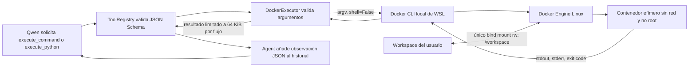

# Arquitectura de la fase 2 — Ejecución en Docker

[Índice](../README.md) · [Roadmap](../../ROADMAP.md) · [Límites](../learning/05-sandbox-docker.md)



## Frontera de confianza

`execute_command` recibe una **lista de argumentos**, por ejemplo
`["python", "-c", "print(19 + 23)"]`. El proceso WSL ejecuta Docker con
`subprocess.Popen(..., shell=False)`; no interpola el texto en un shell del host.
Un modelo puede pedir que el shell exista *dentro* del contenedor, pero no recibe
una herramienta para abrir comandos directamente en WSL o Windows.

El contenedor solo monta la raíz canónica del workspace en `/workspace`. El daemon
debe ser un Docker Engine Linux local por socket Unix o canal local Windows; se
rechazan contextos Docker `tcp://` y `ssh://`, que no podrían montar el workspace
local con certeza. No se monta el socket Docker, el directorio personal, `.git`
ni otras rutas del host.

El contenedor se ejecuta con UID/GID del usuario WSL, sistema raíz de solo lectura,
red desactivada, todas las capabilities retiradas, `no-new-privileges`, `/tmp`
temporal sin ejecución y límites de CPU, memoria, swap, procesos y tiempo. Docker
recibe `--pull=never`: se verifica y ejecuta una imagen ya descargada, sin descargas
implícitas.

## Herramientas

| Herramienta | Entrada | Función |
|---|---|---|
| `execute_command` | `command: list[str]` | Ejecuta directamente argv en el contenedor. Permite varios programas o Python `-c`. |
| `execute_python` | `ruta: str`, `argumentos?: list[str]` | Comprueba un archivo `.py` UTF-8 existente dentro del workspace y lo ejecuta con `python`. |

Ambas devuelven `exit_code`, `stdout`, `stderr`, `timed_out`, `output_truncated` y
`duration_seconds`. stdout y stderr se leen en paralelo, se drenan aunque el modelo
produzca demasiado texto, y se limitan cada uno a 64 KiB por defecto. Un timeout
detiene el contenedor nombrado y retorna código 124; la salida indica `timed_out`.
El proceso no se considera correcto solo por haber producido texto: el modelo recibe
el código de salida y decide qué comunicar.

## Capas de aislamiento y límites

Docker limita el contenedor usando cgroups de Linux. El comportamiento de límites
depende del Docker Engine y de que WSL/Docker Desktop permita aplicarlos. El contenedor
comparte el kernel Linux del daemon; es una barrera de permisos y recursos adecuada
para esta fase, no una máquina virtual independiente ni una garantía frente a fallos
del kernel. El acceso al único directorio bind-mounted es intencional: el script puede
modificar archivos allí; esas acciones no se revierten al retirar el contenedor.

El ejecutor monta únicamente `workspace`; Docker debe estar integrado con la misma
distro Ubuntu que ejecuta el agente. Las pruebas unitarias inyectan respuestas Docker
simuladas; no demuestran el aislamiento real. Las pruebas marcadas `docker` y la
aceptación marcada `acceptance` requieren Docker Desktop iniciado, integración WSL,
daemon local y `python:3.10-slim` descargada.

## Errores y comprobación

`python -m ai_agent_lab.main --check` comprueba primero Ollama y después contexto local, Docker Engine Linux
y la presencia local de la imagen. No crea el workspace ni descarga imágenes. Si falta
algún requisito, presenta una instrucción concreta.

```bash
docker info
docker pull python:3.10-slim
AI_AGENT_LAB_TEST_DOCKER=1 python -m pytest -m docker -v
AI_AGENT_LAB_TEST_OLLAMA=1 AI_AGENT_LAB_TEST_DOCKER=1 \
  python -m pytest -m acceptance -v
```

En la CLI real, habilita en Docker Desktop **Settings → Resources → WSL Integration →
Ubuntu-22.04**. Reinicia la terminal WSL y vuelve a comprobar `docker info`. El agente
no levanta el daemon ni descarga imágenes por su cuenta.
